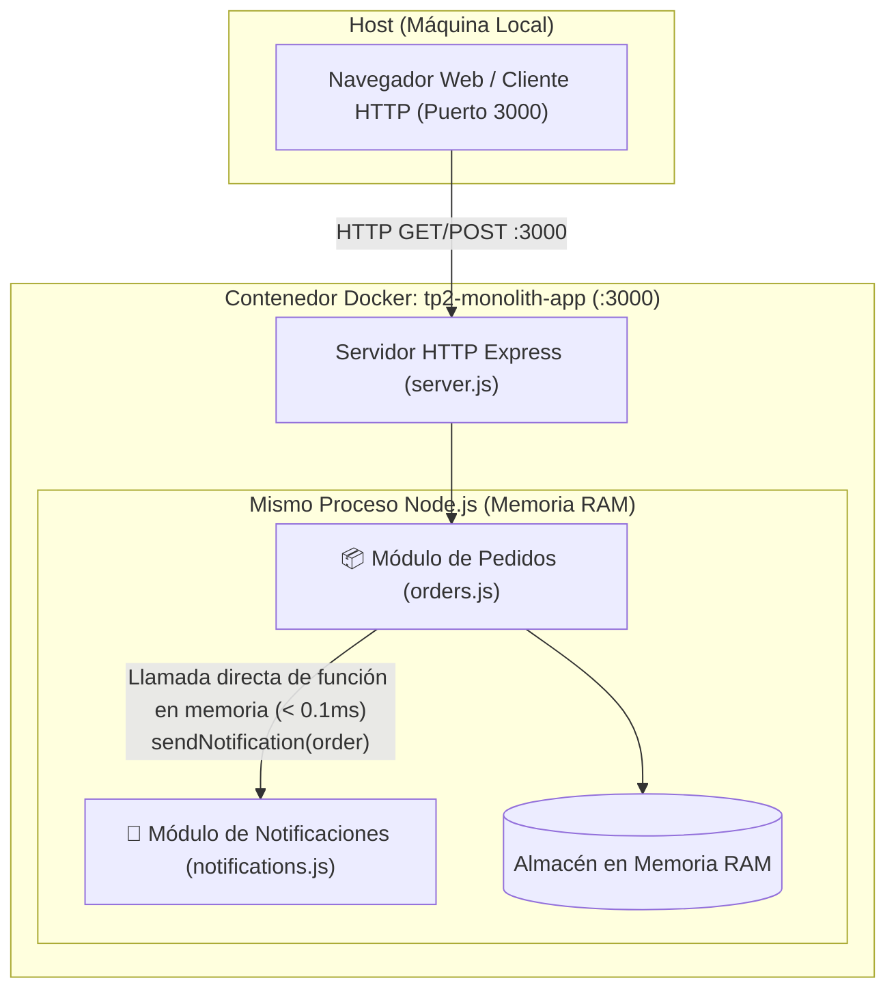
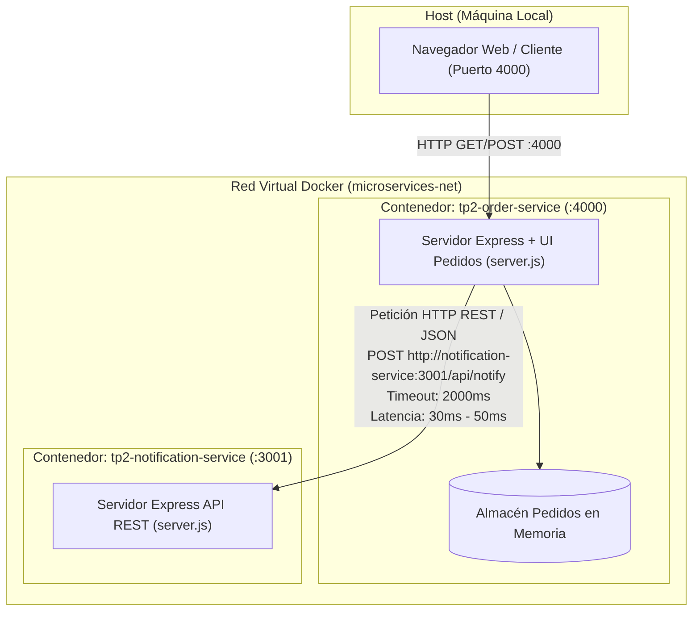

# 📐 Documento de Arquitectura de Software

Este documento describe la topología, diseño de componentes, flujos de datos y comunicación de las dos variantes del sistema desarrolladas para el TP 2.1 de DevOps.

---

## 1. Escenario 1: Monolito Modular

### 1.1 Diagrama de Arquitectura

### 1.2 Características Técnicas
- **Contenedor:** `tp2-monolith-app`
- **Puerto expuesto:** `3000:3000`
- **Mecanismo de Comunicación:** Llamada síncrona/asíncrona a método en memoria (`notificationsModule.sendNotification()`).
- **Latencia de llamada entre módulos:** **< 0.1 ms** (cero sobrecarga de red).
- **Manejo de Memoria:** Memoria compartida del heap de V8 (Node.js).
- **Aislamiento de Fallos:** **Nulo**. Una excepción no capturada (`uncaughtException`) o corrupción en el módulo de notificaciones finaliza todo el proceso Node.js (`PID`), provocando la caída completa del contenedor y dejando inaccesible el módulo de pedidos.

---

## 2. Escenario 2: Microservicios Distribuidos

### 2.1 Diagrama de Arquitectura

### 2.2 Características Técnicas
- **Contenedores:**
  - `tp2-order-service`: expuesto en el host en el puerto `4000:4000`.
  - `tp2-notification-service`: expuesto en el host en el puerto `4001:3001` y accesible internamente en `http://notification-service:3001`.
- **Red:** `microservices-net` (Docker Bridge Network con DNS interno embebido de Docker).
- **Mecanismo de Comunicación:** Peticiones HTTP REST sobre sockets TCP/IP con payloads serializados en JSON.
- **Latencia de llamada entre servicios:** **30 ms - 50 ms** (stack TCP/IP, resolución de nombre de host, serialización/deserialización).
- **Aislamiento de Fallos:** **Total**.
  - Si `notification-service` sufre una caída (HTTP 503, crash o contenedor detenido con `docker stop`), `order-service` sigue 100% operativo.
  - Implementa el patrón **Graceful Degradation** (Degradación Elegante): la orden se confirma y almacena localmente, mientras que la notificación queda registrada en estado `DEGRADED_FAILED` para reintento posterior.

---

## 3. Matriz Comparativa de Arquitectura

| Dimensión | Monolito Modular | Microservicios |
| :--- | :--- | :--- |
| **Límites de Componentes** | Lógicos (carpetas, archivos y módulos de código) | Físicos (procesos y contenedores independientes) |
| **Medio de Transporte** | Llamada a función en memoria RAM | Peticiones HTTP / TCP en red virtual |
| **Latencia Intermódulos** | Inapreciable (< 0.1 ms) | Medible (30 - 50 ms) |
| **Impacto de Falla (Blast Radius)** | Catastrófico (se cae todo el sistema) | Aislado (solo se degrada la función secundaria) |
| **Despliegue y CI/CD** | Un único artefacto / imagen Docker | Múltiples imágenes, orquestador (Docker Compose / K8s) |
| **Escalabilidad** | Monolítica (se replica toda la aplicación) | Independiente (se escala solo el servicio saturado) |
